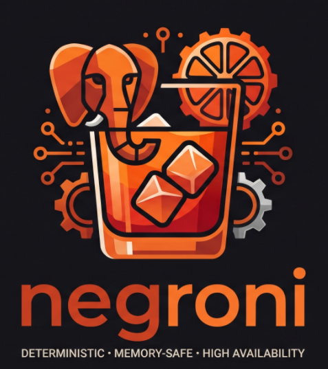

<div align="center">
  
  <br><br>
  <p><b>Deterministic, memory-safe 1:1 Rust implementation of Patroni for PostgreSQL 15–18 High Availability.</b></p>
</div>

---

# Negroni

**PostgreSQL High Availability, Distilled in Rust.**  
*Same battle-tested recipe as Patroni. Zero runtime hangover.*

[](LICENSE)
[-orange.svg)](https://www.rust-lang.org/)
[](https://www.postgresql.org/)
[](https://github.com/<owner>/negroni/actions/workflows/ci.yml)

**Negroni** is a deterministic, memory-safe, **1:1 wire-compatible Rust implementation of [Patroni 4.1+](https://github.com/patroni/patroni)** scoped to **PostgreSQL 15 through 18** (and Citus 12+). It compiles into a single static multicall Linux/POSIX binary (`negroni`) that also serves as `patronictl` and `negronictl`.

> **Project Status:** Pre-v0.1 active development. Architecture (`HLD` & `LLD`) and simulation specifications are locked; Phase 0–1 workspace implementation is underway. See [`docs/IMPLEMENTATION_PLAN.md`](docs/IMPLEMENTATION_PLAN.md) for live progress.

---
> Status: **experimental**
---

## Why Negroni?

Patroni's consensus model, DCS schema, and operational workflows are the gold standard for PostgreSQL High Availability. Negroni keeps **100% of Patroni's external contracts** while solving the operational friction of running a multi-threaded Python supervisor on production database hosts:

- **Immunity to `vm.overcommit_memory=2` Deadlocks:** PostgreSQL best practices mandate strict Linux memory overcommit (`vm.overcommit_memory=2`). Under memory pressure, Python 3.11+ thread creation in upstream Patroni can throw `MemoryError` or hang indefinitely—wedging the REST API while PostgreSQL stays up. Negroni pre-allocates its OS watchdog thread, fixed Tokio worker stacks, and bounded channels at boot (~10–15 MB RSS), eliminating runtime thread-allocation failures permanently.
- **Isolated Hardware Watchdog Fencing (`/dev/watchdog`):** Watchdog `ioctl` keepalives run on a dedicated non-async OS thread spawned *before* the Tokio runtime starts. Even if async tasks stall, hardware fencing triggers deterministically before any replica's DCS lease `ttl` expires.
- **Nanosecond Lock-Free Health Probes:** HAProxy, Envoy, and Kubernetes probes (`/primary`, `/replica`, `/read-write`, `/synchronous`, `/quorum`) read from an atomic `ArcSwap` snapshot (~15ns, zero mutexes, zero SQL). Local PostgreSQL control queries run strictly over **one serialized Unix-socket connection**, guaranteeing probe storms never exhaust `superuser_reserved_connections`.
- **Single Static Multicall Binary:** One `musl`-linked static binary (`~12–15 MB`) replaces Python virtualenvs, C headers, `psycopg` wheels, and `PyInstaller` wrappers. Symlinking `patronictl` or `negronictl` to `negroni` provides the full 19-command CLI out of the box.
- **Live Mixed-Node Rolling Migrations:** Because Negroni speaks Patroni's exact DCS JSON payloads, Kubernetes annotations, REST status codes, `patroni.yml` syntax, and `PATRONI_*` environment variables, you can migrate a live 3-node Patroni cluster to Negroni one node at a time with zero downtime.

---

## Compatibility & Scope Matrix

### PostgreSQL 15–18 Modern Core
Negroni intentionally drops legacy PostgreSQL 9.3–14 baggage (`recovery.conf` files, `pg_xlog_*` SQL branching) to focus 100% on supported community releases (**PG 15, 16, 17, and 18**):
- **Unified Signal & GUC Supervision:** Native `standby.signal` / `recovery.signal`, unit-normalized `postgresql.conf` diffing (`postgresql.base.conf` preservation), `pg_rewind --restore-target-wal`, PG 16+ `include_dir`/`/regex/` HBA rules, PG 18 `oauth` auth, and PG 18 default `initdb` checksums.
- **Dual-Mode Replication Slot Manager:** Supports Patroni permanent slots (`pg_replication_slot_advance()`) on **PG 15–16** and coordinates cleanly with PostgreSQL's native **`failover = true` `slotsync` worker** on **PG 17–18** (including automatic `dbname` injection in `primary_conninfo` and stale unsynced slot cleanup on demoted primaries).
- **Enterprise Topologies:** Priority (`FIRST N`) and quorum (`ANY N`) synchronous replication, **DCS Failsafe Mode** (`/failsafe`), cross-region **Standby Clusters**, and **Citus** coordinator/worker `pg_dist_node` synchronization.

### Distributed Configuration Stores (DCS)

| DCS Backend | Cargo Feature | Default | Rolling Upgrade from Patroni 4.1+ |
| :--- | :--- | :---: | :--- |
| **etcd v3** (gRPC + Leases) | `dcs-etcd3` | Yes | Live mixed-node compatible |
| **Kubernetes** (`Endpoints` / `Lease` + `ConfigMap`) | `dcs-kube` | Yes | Live mixed-node compatible |
| **Consul** (Sessions + Blocking Queries) | `dcs-consul` | Yes | Live mixed-node compatible |
| **ZooKeeper** | `dcs-zookeeper` | Yes | Live mixed-node compatible |
| **Embedded Raft** (`openraft`) | `dcs-raft` | Yes | Requires standby-cluster switchover* |
| **etcd v2 / Exhibitor** *(Legacy)* | `legacy-dcs` | Opt-in | Live mixed-node compatible |

*\*Upstream Patroni's standalone `raft` mode (`pysyncobj`) frames log entries using Python's `pickle` serialization over TCP. For security and stability, Negroni implements standalone Raft natively via `openraft` using the same `raft:` YAML configuration stanza.*

---

## Architecture at a Glance

```text
+-----------------------------------------------------------------------------------+
|                        negroni Multicall Daemon Process                           |
|                                                                                   |
|  +-----------------------------+         Monotonic LeaseProof (epoch, valid_until)|
|  | Dedicated OS Thread         | <---------------------------------------------+  |
|  | Watchdog Keeper (rustix)    |  /dev/watchdog ioctl (NO Tokio, NO network)   |  |
|  +-----------------------------+                                               |  |
|                                                                                |  |
|  +-- Tokio Multi-Thread Runtime (Fixed Workers & Pre-Allocated Stacks) --------|--+
|  |                                                                             |  |
|  |  [DCS Adapter Actor] <---> [HA Coordinator (Pure Deterministic Reducer)] ---+  |
|  |                                    |                        |                  |
|  |                                    v                        v                  |
|  |                    [Postgres Supervisor Actor]    [Background Job Supervisor]  |
|  |                     - Linux pidfd adoption         - initdb / pg_basebackup    |
|  |                     - 1 Serialized SQL Socket      - wal-g / pgbackrest        |
|  |                     - Dual-Mode Slot Manager       - pg_rewind & /failsafe     |
|  |                                    |                                           |
|  |                                    v                                           |
|  |                     [ArcSwap<PublishedNodeState>]                              |
|  |                                    | (~15ns lock-free reads)                   |
|  |                                    v                                           |
|  |              [REST API & Prometheus Metrics (axum + rustls)]                   |
|  +--------------------------------------------------------------------------------+
+-----------------------------------------------------------------------------------+
```

---

## Quickstart & Drop-In Usage

Negroni reads unmodified `patroni.yml` files and honors all `PATRONI_*` environment variables (plus `NEGRONI_*` aliases):

```bash
# Run the HA daemon with an existing Patroni configuration
negroni /etc/patroni/patroni.yml

# Invoke the CLI via subcommand or symlink (negronictl / patronictl)
ln -s /usr/local/bin/negroni /usr/local/bin/negronictl
ln -s /usr/local/bin/negroni /usr/local/bin/patronictl

negronictl -c /etc/patroni/patroni.yml list
negronictl -c /etc/patroni/patroni.yml topology
negronictl -c /etc/patroni/patroni.yml switchover
```

### Building from Source

Requires Rust **1.85+** (`2024` edition):

```bash
git clone [https://github.com/](https://github.com/)<owner>/negroni.git
cd negroni

# Standard release build (etcd3, Kubernetes, Consul, ZooKeeper, OpenRaft, Citus, systemd)
cargo build --release

# Minimal static build (e.g., etcd v3 + systemd only, musl target)
cargo build --release --target x86_64-unknown-linux-musl \
  --no-default-features --features "dcs-etcd3,systemd"
```

---

## Design & Engineering Documentation

- **[High-Level Design (`docs/HLD.md`)](docs/HLD.md):** System invariants, concurrency isolation, DCS keyspace contracts, state machine flows, and watchdog timing equations.
- **[Low-Level Design (`docs/LLD.md`)](docs/LLD.md):** Cargo workspace manifests, `DcsBackend` trait, cancel-safe `NodeCtx::step` reducer, PG 15–18 capability matrix, dual-mode slot reconciliation, REST API routes, and CLI parity contract.
- **[Implementation Plan (`docs/IMPLEMENTATION_PLAN.md`)](docs/IMPLEMENTATION_PLAN.md):** Phased milestone breakdown from workspace bootstrap to Patroni Behave (Gherkin) and Jepsen verification.
- **[Agent & Contributor Manual (`AGENTS.md`)](AGENTS.md):** Strict architectural red lines, crate dependency DAG, and verification gates.

---

## License

Released under the [MIT License](LICENSE), matching upstream Patroni.
